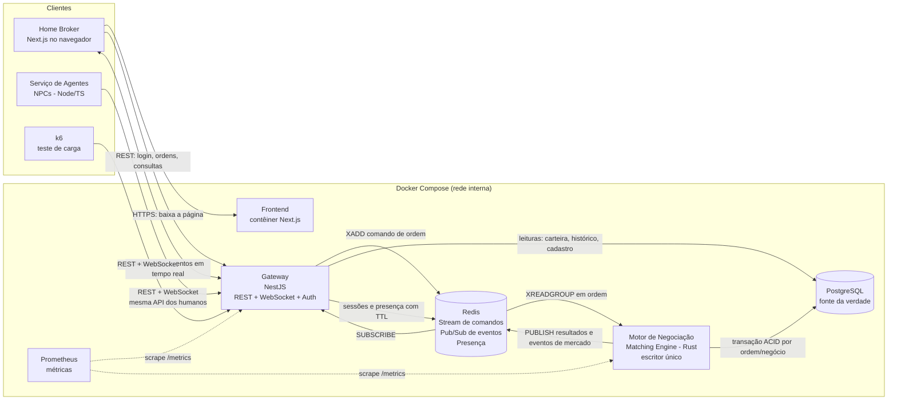
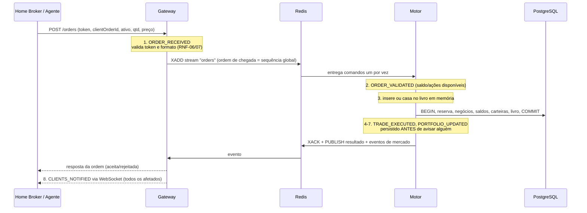

# System Design — Simulador de Bolsa de Valores Multiplayer

> Baseado em: `requirements.md` (v1.0, 30/09/2026)
> Status: Rascunho
> Cobre os itens da Parte 1 (§12.1 do PDF): arquitetura proposta, diagrama de componentes, tecnologias, protocolos, banco de dados, estratégia de consistência e estratégia de tolerância a falhas.

## 0. Resumo em linguagem simples

O jogador usa um Home Broker no navegador. Ele conversa com um único ponto de entrada, o **Gateway**, que confere quem é o jogador, repassa as ordens e empurra as atualizações para a tela em tempo real. As ordens não são processadas no Gateway. Elas entram numa **fila única** e são processadas **uma de cada vez** por um **Motor de Negociação** separado. É como um único caixa atendendo uma fila organizada: por construção, duas ordens nunca gastam o mesmo dinheiro. Cada negócio é gravado no **PostgreSQL** numa transação "tudo ou nada" antes de qualquer tela ser avisada. Por isso, se o motor cair, ele volta, relê o banco e continua de onde parou. Os **agentes automáticos** rodam em um contêiner próprio e operam pelo mesmo Gateway que os humanos, com as mesmas regras. Tudo sobe com um `docker compose up`.

## 1. Diagrama de Arquitetura

### 1.1 Componentes (topologia)

*Visualize colando em https://mermaid.live*

### 1.2 Fluxo de uma ordem (os 8 passos do §6 do PDF)

## 2. Componentes Principais

| Componente | Tecnologia | Responsabilidade | Por que existe separado |
|---|---|---|---|
| **Frontend (Home Broker)** | Next.js (React) + TypeScript, servido em contêiner próprio | Telas de login/cadastro e painel (carteira, mercado, formulário de ordem, livro, histórico). Só exibe dados e envia comandos (RNF-10). | Cliente e servidor são papéis diferentes na arquitetura cliente-servidor exigida. Usado como SPA: sem lógica de mercado no servidor Next. |
| **Gateway** | NestJS (TypeScript), REST + WebSocket (`@nestjs/websockets` com `ws`) | Porta de entrada única. Cuida de cadastro/login, emissão e validação de token, autorização (RNF-08), validação de parâmetros (RNF-07), consultas de carteira/histórico, repasse de ordens ao motor, entrega de eventos por WebSocket e presença de conectados (RF-003, RF-023). | Isola a borda (muitas conexões, autenticação, protocolo) do núcleo que precisa ser sequencial. Não guarda estado próprio: tudo fica no Redis/Postgres. Por isso pode ser reiniciado ou replicado sem perda (RNF-13). |
| **Motor de Negociação (Matching Engine)** | **Rust** (runtime `tokio`, `redis` para o stream, `sqlx` para o Postgres, `serde` para JSON) | Único componente que **altera dinheiro, ações e livro**. Consome os comandos em ordem, valida saldo/reservas, casa ordens por preço + tempo (RF-013 a RF-017), liquida cada negócio numa transação e publica os eventos. | É o coração da consistência (RNF-01). Precisa ser um **escritor único**, e isolá-lo deixa isso explícito e verificável. Também é o contêiner que derrubamos na demonstração de falha (CA-05) sem derrubar as conexões dos clientes. |
| **Serviço de Agentes** | Node.js + TypeScript | Roda ≥ 5 NPCs com perfis conservador/agressivo (RF-019, RF-020) e, como *Could*, reage a eventos econômicos (RF-021). | Os agentes são **clientes** do mercado e usam a mesma API dos humanos. Assim garantem as mesmas regras e validações sem código duplicado. Podem ser ligados, desligados ou escalados sem tocar no servidor. |
| **Redis** | Redis 7 | (a) **Stream** `orders`: fila de comandos com ordem total e confirmação (ack). (b) **Pub/Sub**: eventos do motor para o(s) gateway(s). (c) **Presença** de conectados com expiração (TTL). | Uma única peça cobre fila, difusão de eventos e presença (ver §4 e §6). **Não é fonte da verdade**: se for zerado, nada financeiro se perde. |
| **PostgreSQL** | PostgreSQL 16, volume Docker persistente | Fonte da verdade: usuários, saldos, reservas, carteiras, ativos, ordens, negócios e histórico (RF-022). | Banco único (ver §3). |
| **Prometheus** | Prometheus | Coleta as métricas de RF-026 expostas em `/metrics` pelo Gateway e pelo Motor. Grafana é opcional (RF-027, *Could*). | Ferramenta pronta e padrão para métricas; dá os números do relatório de carga (CA-04). |
| **k6** (ferramenta, não roda em produção) | k6 | Simula 5, 20 e 50 (e 100+) usuários via REST + WebSocket (RNF-04). | Só existe no teste de carga. |

**Linguagens: TypeScript na borda e Rust no núcleo (decisão do grupo).** Gateway, Frontend e Agentes usam TypeScript, a mesma linguagem ponta a ponta no que fala com o usuário. O Motor usa Rust, e há bons motivos para isso: o compilador impede, antes mesmo de rodar, as corridas de dados (*data races*) que o §7.3 do PDF manda evitar; não há coletor de lixo, então a latência fica previsível no teste de carga; e o binário sobe e recupera o livro em segundos na demo de falha (CA-05). Como as duas linguagens só conversam **por mensagens JSON via Redis**, nunca por chamada direta, o formato das mensagens (ordem, resultado, evento, erro) é o **contrato** entre elas. Ele fica documentado num único lugar (JSON Schema), com os tipos TS e as structs Rust escritos a partir dele. Um teste de contrato confere que os dois lados serializam igual.

## 3. Escolha de Banco de Dados

**Escolha:** PostgreSQL 16 (uma instância, em contêiner, com volume persistente).

| Critério | Escolhida: PostgreSQL | Descartada: MongoDB | Descartada: banco distribuído (CockroachDB/Citus) |
|---|---|---|---|
| Liquidação atômica de um negócio (RF-016) | Transação ACID em várias tabelas com `BEGIN/COMMIT` | Transações multi-documento existem, mas exigem réplica e são menos naturais | Atende (ACID distribuído) |
| Nunca deixar saldo/ações negativos (RNF-01) | `CHECK (saldo >= 0)` e `CHECK (qtd >= 0)` no próprio banco, uma **segunda barreira** além do motor | Sem restrição equivalente declarativa | Atende |
| Consistência forte para saldo, carteira e livro (RNF-05) | Leitura após commit sempre vê o resultado | Depende de *read/write concern* configurado | Atende, com latência maior entre nós |
| Dados com relações (usuário → ordens → negócios → carteira) | Modelo relacional encaixa naturalmente | Exige desnormalizar ou fazer junções na aplicação | Igual ao Postgres |
| Custo para a equipe e para a demo | Conhecido, 1 contêiner, ~100 MB de RAM | 1 contêiner | ≥ 3 nós para fazer sentido; configuração e depuração muito mais caras |

**Requisitos que decidiram:** RF-016 e RNF-01 (atomicidade e não-negatividade) e RNF-05 (consistência forte).

**Sobre a recomendação de "banco distribuído" (§7.6 do PDF):** o volume máximo é de 50 a 100 usuários, e uma instância de Postgres atende com folga de várias ordens de grandeza. Distribuir o banco não resolve nenhum requisito obrigatório e traria a parte mais difícil de depurar para o caminho crítico do projeto. A decisão fica registrada como **diferencial possível** (§6): CockroachDB fala o protocolo do PostgreSQL, então a troca seria de configuração, não de código.

## 4. Comunicação e Rede

| Trecho | Protocolo | Justificativa |
|---|---|---|
| Navegador → Frontend | HTTP | Só entrega a página. |
| Cliente → Gateway (comandos) | **HTTP/REST + JSON** | Comandos são pedido-resposta (login, enviar/cancelar ordem, consultar carteira). REST é simples de testar (curl, k6) e dá códigos de erro claros (400 inválido, 401 sem sessão, 403 ordem de outro usuário). |
| Gateway → Cliente (tempo real) | **WebSocket** | O servidor precisa **empurrar** eventos sem o cliente pedir (RF-018), em ≤ 1 s p95 (RNF-02). Consultar o servidor em intervalo curto (*polling*) multiplicaria requisições por 50 usuários e ainda teria atraso. O WebSocket também serve de **batimento cardíaco** para detectar desconexão (RF-023). |
| Gateway → Motor | **Redis Stream** `orders` (fila com confirmação) | Dá uma **sequência única** de chegada definida no servidor (RF-014, RNF-01): o ID da entrada no stream é o carimbo de ordem. A entrada só é confirmada (`XACK`) depois do commit no banco (RF-024). |
| Motor → Gateway(s) | **Redis Pub/Sub** | Difusão de "aconteceu X" para todos os gateways, que repassam aos WebSockets dos interessados. |
| Gateway / Motor → PostgreSQL | Protocolo nativo do Postgres | — |

**Por que uma fila aqui, se o padrão KISS é não ter fila?** Três requisitos a justificam:
1. **RNF-01 / RF-014:** com Gateway e Motor em processos separados, ordens de vários clientes chegam em paralelo. A fila transforma chegadas simultâneas numa **ordem total** antes do motor, e é essa a política de ordenação que o §7.3 do PDF pede para definir.
2. **RF-024 / CA-05:** se o motor cair, os comandos esperam na fila em vez de se perder em conexões HTTP interrompidas, e o Gateway continua de pé atendendo consultas e mantendo os WebSockets.
3. **RNF-13 e §7.1 ("adotar serviços sempre que possível"):** a fila é o que permite separar os serviços sem acoplá-los por chamadas síncronas.

**Por que Redis e não RabbitMQ:** o sistema precisa de três coisas (fila ordenada com ack, difusão de eventos e presença com expiração), e o Redis faz as três com um contêiner só. O RabbitMQ faria as duas primeiras, e a presença exigiria outra peça. Para ~50 usuários, a garantia extra de entrega do RabbitMQ não compensa um componente a mais para configurar e monitorar.

**Resposta ao cliente:** o `POST /orders` só responde depois que o motor processou e gravou (aceita/rejeitada com motivo), com **timeout de 3 s**. Estourou o prazo? O cliente recebe "não confirmada, reenvie". Cada ordem carrega um `clientOrderId` gerado pelo cliente, e o motor ignora duplicatas desse ID. Assim um reenvio nunca gera ordem dupla.

**Integrações externas:** nenhuma (§3.3 do SRS).

## 5. Consistência, Concorrência, Cache, Escalabilidade e Resiliência

### 5.1 Estratégia de consistência (exigida no §7.3 do PDF)

| Dado | Modelo | Como é garantido |
|---|---|---|
| Saldo, reservas, carteira, ordens, negócios | **Forte** | Um **único escritor** (o Motor) processa os comandos **sequencialmente**, sem paralelismo entre ordens, nem de ativos diferentes, porque o saldo é compartilhado entre ativos. Cada ordem e seus negócios são gravados em **uma transação** Postgres (RF-016). `CHECK`s no banco impedem valores negativos mesmo se houver bug. Leituras da carteira vão direto ao Postgres. |
| Livro de ofertas | **Forte** no motor | Mantido em memória no motor (estruturas ordenadas por preço + tempo), sempre espelhado no Postgres na mesma transação. Em memória para rapidez, no banco para recuperação. |
| Painel de mercado nos clientes (preço, variação, volume, top-5 do livro) | **Eventual, ≤ 1 s** (RNF-05) | Derivado de eventos via WebSocket. Um atraso de milissegundos no preço exibido não causa erro financeiro, porque a validação real acontece no motor. Ao (re)conectar, o cliente recebe um *snapshot* completo antes dos eventos incrementais. |

**Por que processar tudo em sequência não é gargalo:** com 50 usuários e 5 a 10 agentes, a carga esperada fica na casa de dezenas de ordens por segundo. Um laço sequencial em Rust com uma transação Postgres por ordem processa centenas por segundo, e o limite passa a ser o banco, não o motor. Dentro do motor, o livro de ofertas pertence a **uma única tarefa** (sem `Mutex` compartilhado), então a exclusão mútua é garantida pela estrutura e verificada pelo compilador. O teste de carga (RNF-04) vai medir o limite real, e esse número entra no relatório.

**Reserva de saldo (RF-009, RF-010):** ao aceitar uma compra, o motor move `qtd × preço` de "disponível" para "reservado" na mesma transação. Numa execução a preço melhor, a diferença volta ao disponível (RF-015). No cancelamento, a reserva é liberada (RF-012).

### 5.2 Cache
- **Cache distribuído:** não é necessário nesta fase. O Postgres responde as leituras de carteira/histórico de 50 usuários em milissegundos.
- **Snapshot de mercado:** o Gateway guarda em memória o último estado de mercado recebido do motor, para entregar a quem conecta sem consultar o banco. É o único "cache", e é descartável.

### 5.3 Escalabilidade
- **Gateway:** sem estado próprio, então pode ter N réplicas atrás de um balanceador (o Pub/Sub do Redis entrega eventos a todas). **Não faz parte da base.** Fica como diferencial barato (§6).
- **Motor:** escala **verticalmente** (1 instância). Particionar por ativo exigiria coordenar o saldo compartilhado entre partições (transação distribuída), e isso está fora do escopo.
- **Gargalo esperado:** a transação Postgres por ordem no motor. É onde olhar primeiro se o teste de 100+ usuários degradar.

### 5.4 Resiliência e tolerância a falhas (exigida no §7.5 do PDF)

| Falha | Como é detectada | Reação do sistema | Estado preservado |
|---|---|---|---|
| **Cliente perde a conexão** (RF-023) | WebSocket fecha ou para de responder ao *ping* (a cada 5 s). A chave de presença no Redis expira em 10 s. | Marcado como desconectado; os demais clientes recebem o evento. **As ordens abertas continuam no livro** e podem ser executadas. | Tudo: está no Postgres. |
| **Cliente reconecta** (RF-004, RNF-11) | O Home Broker tenta a cada ≤ 5 s com o token ainda válido. | O Gateway valida o token sem pedir login e envia um snapshot (saldo, carteira, ordens abertas, mercado). | Tudo. |
| **Motor cai** (RF-024, **demo CA-05**) | Fim do batimento do motor no Redis e métricas zeradas no Prometheus. O Gateway detecta respostas não confirmadas por timeout. | Docker reinicia o contêiner (`restart: unless-stopped`). O motor **reconstrói o livro em memória a partir das ordens abertas no Postgres** e volta a consumir o stream. Ordens em andamento sem commit: o cliente recebe "não confirmada, reenvie" (regra do SRS) e o `clientOrderId` impede duplicidade. O Gateway e os WebSockets **continuam de pé**, e os clientes veem o aviso "mercado temporariamente indisponível". | Tudo o que foi confirmado, porque confirmar = commit. |
| **Gateway cai** | Os clientes perdem o WebSocket. | Docker reinicia; os clientes reconectam sozinhos (RNF-11) e as sessões continuam válidas (token). | Tudo. |
| **Redis cai** | Erro de conexão no Gateway/Motor. | Novas ordens são recusadas com erro claro até ele voltar. A presença é reconstruída pelos próximos *pings*. | Nada financeiro se perde (Redis não é fonte da verdade). Comandos na fila sem ack são tratados como "não confirmados". |
| **Postgres cai** | Erro de conexão. | O motor para de consumir (não confirma nada sem commit), e os comandos esperam na fila. | Volume Docker persistente. Backup: `pg_dump` antes da demo. |

**Ponto único de falha aceito:** Postgres e Motor têm uma instância cada. Para um projeto acadêmico com demo ao vivo, reiniciar em segundos com estado íntegro é o comportamento exigido (R11). Replicá-los fica em §6.

### 5.5 Segurança (R14)
- Senhas com hash **argon2** ou **bcrypt** (RNF-06).
- Login gera **JWT** assinado (validade de 8 h), exigido em toda rota REST e na abertura do WebSocket (RF-002).
- O motor sempre usa o `userId` extraído do token pelo Gateway, **nunca** um ID enviado pelo cliente. Por isso ninguém envia ou cancela ordem em nome de outro (RNF-08).
- Validação de esquema de todo parâmetro no Gateway (`class-validator` do NestJS) e revalidação de regra de negócio no motor (RNF-07).
- Só o Frontend e o Gateway expõem portas. Redis, Postgres e Motor ficam na rede interna do Compose.

### 5.6 Observabilidade (R13)
- **Logs estruturados em JSON** (um por linha) no Gateway (`pino`) e no Motor (`tracing` com saída JSON), sempre com `orderId`, `clientOrderId`, `userId` e o estágio de RF-025 (`ORDER_RECEIVED` … `CLIENTS_NOTIFIED`). Com `docker compose logs | grep <orderId>` dá para ver o caminho completo.
- **Métricas Prometheus:** ordens/s, latência de processamento (histograma, para p95), clientes conectados, erros por tipo, tamanho da fila pendente (RF-026).
- **Grafana:** opcional (RF-027, *Could*).

## 6. Complexidade Descartada

| Opção | Decisão | Motivo |
|---|---|---|
| **RabbitMQ** | Descartado → Redis | O Redis cobre fila + pub/sub + presença num contêiner só (ver §4). |
| **Kafka** | Descartado | Feito para milhões de eventos/s e retenção longa. Pesado para subir e operar numa demo. |
| **Microsserviço de autenticação separado** | Descartado → módulo do Gateway | A autenticação é uma verificação de token por requisição, sem perfil de escala próprio. Separar só acrescentaria uma chamada de rede. O NestJS já a mantém como módulo isolado dentro do Gateway. |
| **Kubernetes / cluster** | Descartado → Docker Compose | O §7.1 pede cluster "quando tecnicamente aplicável". Com ~6 contêineres numa máquina, Compose sobe tudo com um comando (RNF-09). Diferencial possível: Docker Swarm (usa o mesmo arquivo Compose). |
| **Banco distribuído / replicação do Postgres** | Descartado na base; **diferencial possível** | Ver §3. Caminho de menor custo: CockroachDB (compatível com o protocolo do Postgres). |
| **Particionar o motor por ativo (sharding)** | Descartado | O saldo é compartilhado entre ativos, então partições concorrentes exigiriam transação distribuída ou reserva prévia por ativo, justamente o tipo de erro que o projeto precisa evitar. |
| **Event sourcing / CQRS** | Descartado na base | Fora do escopo (§1.2 do SRS). Observação: o stream de comandos + a tabela de negócios já são meio caminho para uma demonstração de event sourcing, se sobrar tempo. |
| **Next.js com lógica no servidor (SSR/API routes)** | Descartado | RNF-10 exige a lógica no servidor de mercado. O Next é usado só como cliente, para evitar um segundo backend escondido. |

**Diferenciais baratos, se sobrar tempo** (§11 do PDF), nesta ordem de custo/benefício:
1. 2 réplicas do Gateway atrás de um balanceador (nginx), que a arquitetura já suporta.
2. Grafana sobre o Prometheus.
3. Circuit breaker no Gateway para o caso de o motor estar fora.
4. Teste de caos automatizado (derrubar o motor durante o k6).

## 7. Suposições e Questões em Aberto

| ID | Suposição/Questão | Quem confirma |
|---|---|---|
| SD-01 | O grupo tem familiaridade suficiente com TypeScript/NestJS para cumprir a Parte 1 (21/10). | Grupo |
| SD-02 | **Bibliotecas e frameworks open source (NestJS, Next.js, ioredis, driver do Postgres, prom-client) não contam como "código de terceiros"** proibido pelo enunciado, que proíbe copiar código escrito por outros, não usar dependências. | **Professor**. Confirmar antes de começar, porque isso muda tudo. |
| SD-03 | Os agentes rodam num contêiner à parte e contam como clientes no teste de carga. O número padrão de agentes (≥ 5) segue a Q-03 do SRS. | Grupo |
| SD-04 | Timeout de confirmação de ordem de 3 s e validade de token de 8 h. Valores ajustáveis após o primeiro teste. | Grupo |
| SD-05 | A demo e os testes rodam numa única máquina com Docker (D-03). Com várias máquinas, apenas o Frontend/Gateway precisam de IP acessível. | Grupo |
| SD-06 | **Risco da escolha do Rust:** é a segunda linguagem do projeto e tem curva de aprendizado maior. Mitigação: (a) 1 ou 2 integrantes ficam donos do motor e os demais revisam só o contrato de mensagens; (b) o protótipo da Parte 1 não precisa de matching (RF-013 a RF-017 são P2), então o motor da P1 pode só aceitar a ordem, gravar e publicar, e isso já exercita toda a comunicação entre as linguagens; (c) se o motor em Rust atrasar a P2, o contrato JSON permite trocar a implementação sem mexer em Gateway, Frontend ou Agentes. | Grupo |
